# 寻找自己的路 — HD2D 叙事步行原型

一尊木偶人独自上路，穿过十一段风景，遇见八个形形色色的人。
每场对话里有**三个选择**，但没有任何一句「你是这样的人吗」：
游戏会从你怎么回答里读出倾向，悄悄决定这段对话要不要把对方的颜色嵌进你胸口的**心形凹槽**里。
凹槽会吸收并混合颜色，最终结局由**你取下的颜色组合**决定；游戏启动后先进入标题菜单；选择「开始游戏」后进入草坡上一位出门木匠的家，再从木屋出去进入草坡序章。


## 运行

| 方式 | 操作 |
| --- | --- |
| 直接玩 | 双击 `运行游戏.bat` |
| 打开编辑器 | 双击 `打开编辑器.bat` |
| 命令行 | `..\_tools\godot\Godot_v4.7.2-stable_win64.exe --path .` |

**窗口**：项目启动直接锁定全屏（`window/size/mode=3`），运行时不切换窗口模式。

**标题菜单**：开始游戏 / 读取游戏 / 设置 / 退出游戏。

**声音**：程序化环境音乐 + UI/脚步/跳跃/对话/取色/道具/解谜/过场音效；音量在设置里调。
**字体**：中文界面改用 Noto Sans SC（OFL），并整体略放大字号，长段对话更好读。

**全屏**：由 `project.godot` 的 `window/size/mode=3` 在启动时直接锁定全屏，代码里不再主动调用 `window_set_mode`，也不在设置页提供窗口切换。

**操作**：`WASD / 方向键` 四向移动（A/D 是横移，不是转身） · 第一人称下鼠标自由看 · `E` 交谈 · `空格 / E` 推进对话、确认选项 · `W/S 或 ↑/↓` 选择选项 · `V` 第一人称 / 俯视视角 · `B / E` 背包 · `Esc` 局内暂停菜单 · 标题菜单 `↑/↓` 选择、`空格 / 回车` 确认 · 开局走到白风车下按 `E` 开始旅程；结局界面按 `空格`，性格画像页再按 `空格` 重新走一遍 · `Esc` 只暂停/返回标题，不会直接退出游戏
标题页：开始游戏 / 读取游戏 / 设置；加载时会显示心形加载图标。加载结束后角色会自动起身（按方向键可以提前起身）

引擎是 Godot 4.7.2-stable，放在项目外的 `F:\游戏制作\_tools\godot\`。

### 加载提示

第一次进入游戏和每次切换地图时，会先出现深色加载页和一颗**脉动、带环绕光点的心形图标**（`scripts/ui/loading_spinner.gd`），不是纯黑屏。

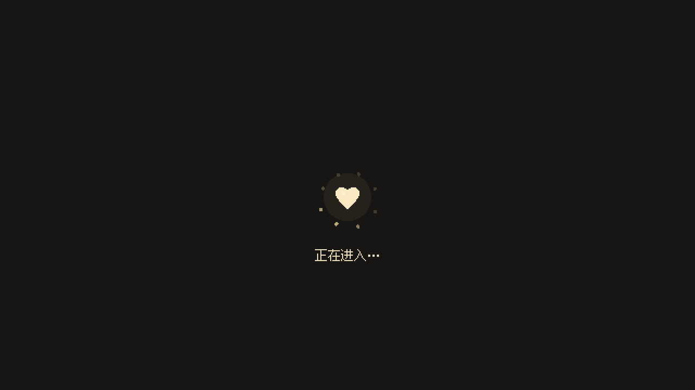

## 游戏流程

主菜单 → 木匠家 → 3D 草坡序章 → 白风车下开始旅程 → 十一段路 → 结局画面 → 按空格查看性格画像 → 再按空格重新走一遍。
不能回头；一次通关最多拿到 8 种颜色（对应 8 个 NPC），全部嵌进胸口的心形凹槽（左上角爱心 HUD 同步显示）；和每个 NPC 好好聊完，还会得到一件他的随身物，收进背包。

| 段 | 氛围 | 内容 |
| --- | --- | --- |
| 一 · 晨光 | 清晨草坡、薄雾 | 独白，无 NPC |
| 二 · 正午 | 正午强光 | **阿燃**（红）信使 |
| 三 · 林间 | 午后林间小径 | **阿衡**（黄）修表匠 |
| 四 · 溪畔 | 冷色薄雾、清澈小溪、木桥 | 独白，无 NPC |
| 五 · 花野 | 傍晚金色花田 | **阿禾**（绿）园丁 |
| 六 · 山道 | 黄昏蓝调、长影 | **阿砚**（蓝）守路人 |
| 七 · 高地 | 暮色紫霞 | **阿遥**（紫）画者 |
| 八 · 木场 | 午后暖橙、木屑 | **阿作**（橙）木匠 |
| 九 · 风坡 | 晨风、淡粉天光 | **阿游**（粉）放风筝的旅人 |
| 十 · 旧阶 | 冷青薄雾、旧石阶 | **阿序**（青）抄书人 |
| 十一 · 山顶 | 夜空 | 独白 → 结局 |

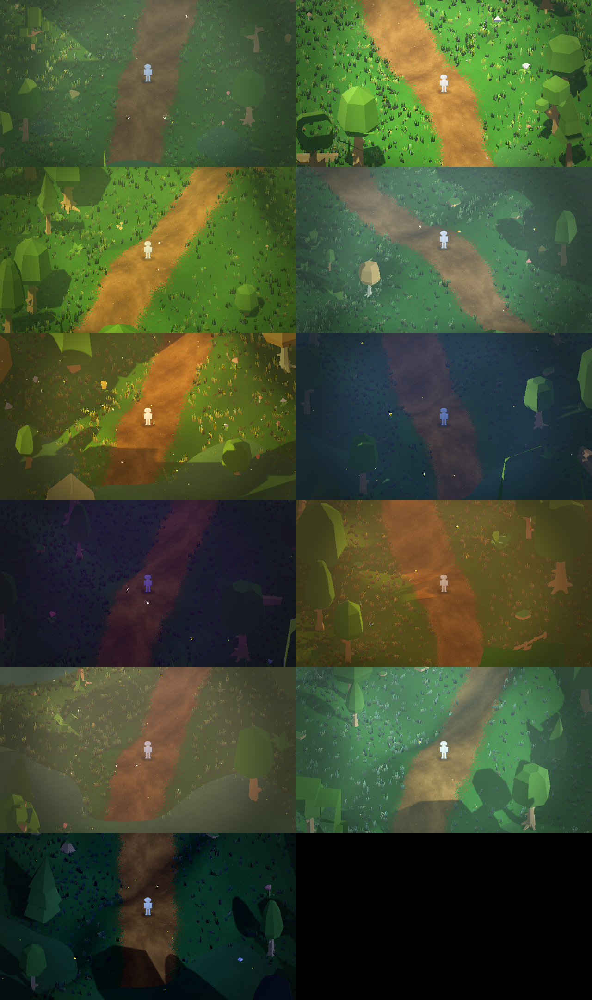

## 开始界面与设置

标题页现在是一个暖白菜单，只有标题、副标题和三个选项：

- **开始游戏**：清空旧存档，从头开始；
- **读取游戏**：读取上次存档（没有存档时灰显，选中会提示「没有可读取的存档」）；读取后直接进入原来的「想起身 → 赖床 → 自动起身」加载演出；
- **设置**：所有操作说明都移到了这里，分成「按键」两列显示（移动 / 跳跃 / 奔跑 / 交谈 / 第一人称 / 推进确认 / 选项 / 菜单），下面是 **音量**（0–100% 循环）和返回主菜单；
- 设置保存在 `user://settings.cfg`，下次启动会沿用音量。全屏始终锁定。
- 菜单支持鼠标点击，也支持 `↑/↓` + `空格 / 回车`；设置页按 `Esc` 返回。


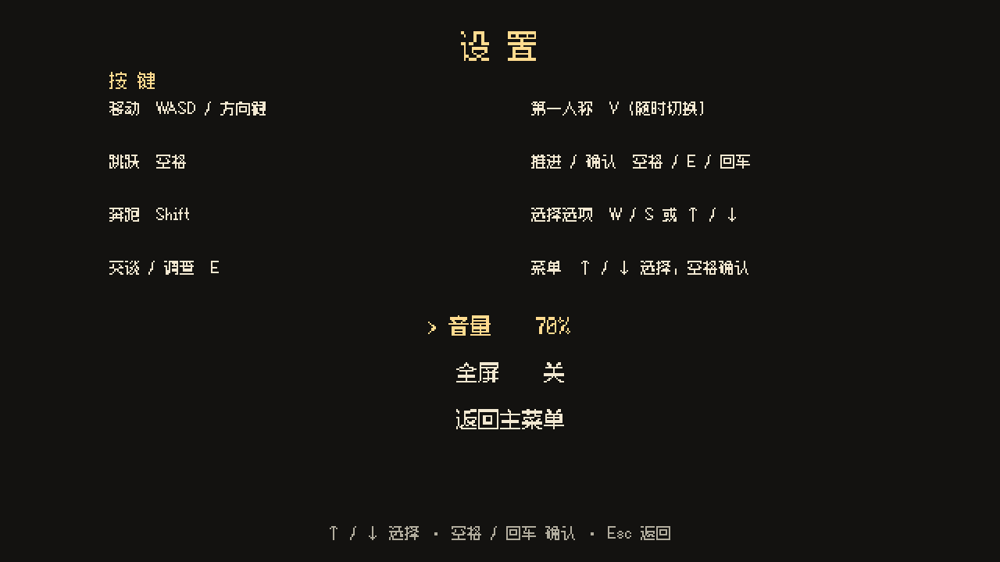

## 局内暂停菜单（Esc）

游戏进行中按 `Esc` 打开暂停菜单：

- **继续游戏**：关闭菜单继续走；
- **设置**：打开与标题页相同的设置页（按键说明、音量、返回）；
- **返回主菜单**：先保存当前进度（段落、位置、已取颜色），再回到标题菜单，之后可以从「读取游戏」继续；
- **退出游戏**：保存进度并退出。

暂停菜单支持鼠标，也支持 `↑/↓` 选择、`空格 / 回车` 确认、`Esc` 继续游戏。

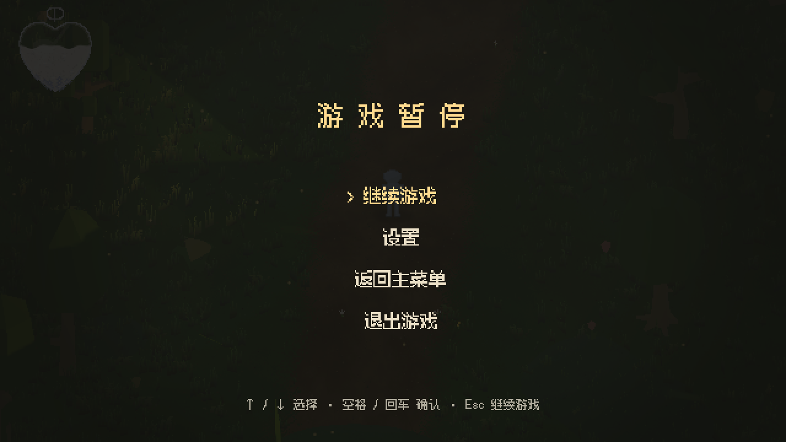

## 第一人称（按 V 切换）

- 在实时场景按 **V** 可随时切到第一人称；再按一次回到原来的 HD2D 俯视构图。
- 第一人称下鼠标环顾，`WASD` 按视线方向移动，Shift 奔跑、空格跳跃不变。
- **只有按 V 才会切换第一/第三人称**；打开暂停菜单、设置、背包、对话或结局都不会切换视角。
- 会隐藏木偶人本体和影子；左上角心形凹槽 HUD、屏幕提示、对话面板都保留。
- 对话会保持当前第一人称视角，不会自动跳回俯视；对话结束继续用第一人称。
- 第一人称参数在 `scripts/camera_rig.gd`：`eye_height`（1.55）、`first_person_fov`（72）、`mouse_sensitivity`。

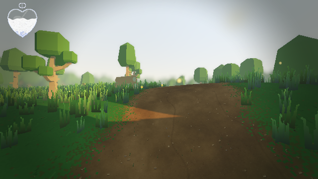
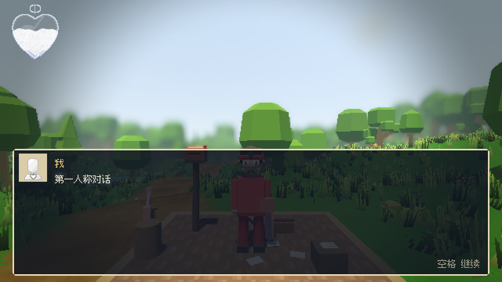

## 回到上次的位置（退出 / 启动演出）

- **退出时**：角色先坐下（约 0.8 秒），然后游戏把**当前画面**（隐藏角色、收起 UI 后截一张背景图）和进度（第几段、精确位置、取过哪些颜色、聊过谁）一起存下来。
- **下次打开**：先显示标题菜单；选「读取游戏」后进入离开时的那张画面，木偶人仍是木头本色，**坐在原地**，左上角的心形凹槽还留着上次的颜色，屏幕上方写着「上次停在 · 三 · 林间」；随后自动播放加载演出。
- **开始后**：先播放「想起身 → 又赖回去」的加载演出（约 3.4 秒，期间正在构建场景；构建慢就一直躺着），加载完成时角色会自动**坐起**，随后淡入实时场景。
- **加载结束**：不再停在“躺着/坐着等按键”——遮罩淡出后约 0.85 秒角色自动起身（约 0.6 秒完成），**不需要按任何键**；期间按方向键可以提前起身。
- 存档为 `user://save/savegame.json` + `last_frame.png`；运行环境不能写用户目录时（便携/沙箱运行）自动退回到项目里的 `save/` 文件夹。每 5 秒自动存一次进度；结局出现时清档（下次从头开始）。

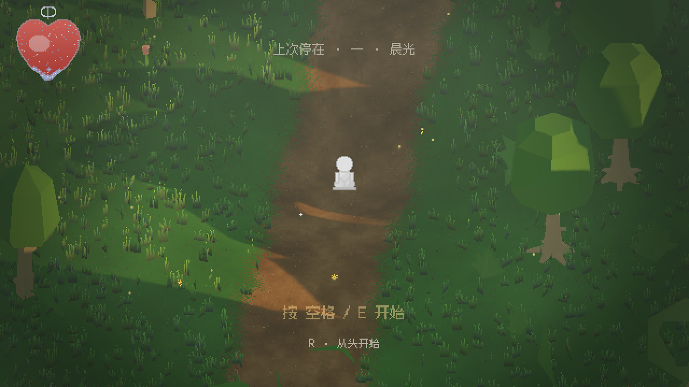
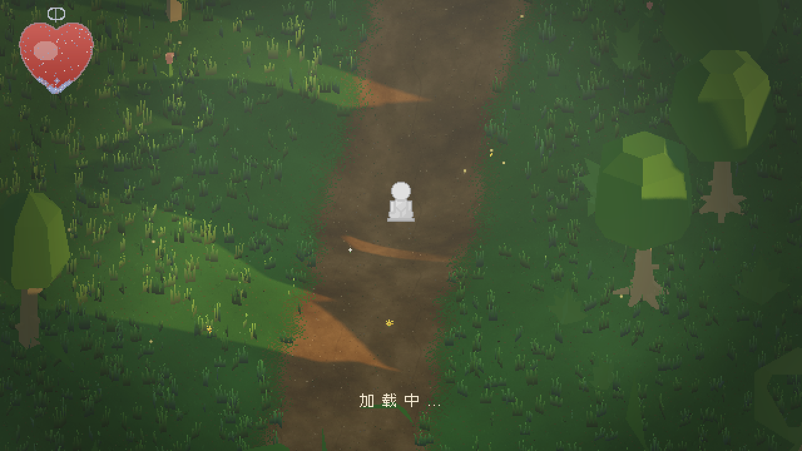
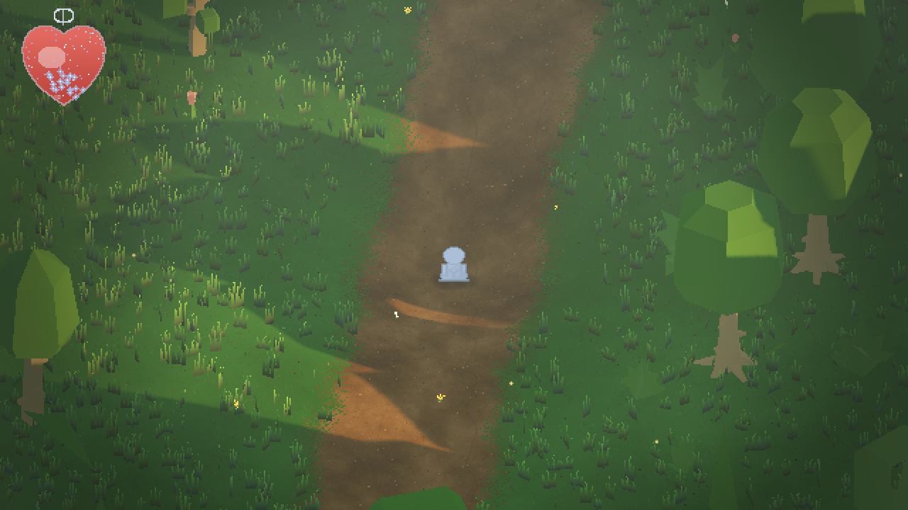

## 胸口的心形凹槽与取色

左上角用一颗**爱心 HUD** 表示胸口的心形凹槽（透明玻璃 + 液体闪粉视觉）：

- 容器是透明玻璃：银边、内圈反光和斜向高光，上半部分能透出后面的风景；液体只装在下半部分，一开始是白色；
- 液体不是干净的单色块，而是有**细密沙粒/悬浮闪粉质感**（多层高频噪点 + 缓慢旋转的云絮），看起来像凹槽里沙沙流动的细沙；
- **玻璃容器本身固定不动**；走路 / 停下时，里面的液体和沙粒会被颠动：液面倾斜、起波，闪粉和沙粒翻滚，停下后慢慢平息；
- 里面的闪粉也会跟着晃动、在爱心里打旋；
- 玩家对话头像里的爱心也会同步显示当前颜色（头像本身始终是白色）。
- 当游戏判断你偏向某个 NPC 时，新颜色会像墨一样旋进液体里，约 1.15 秒混匀成新的混合色；同时闪一下白光、里面的液体被搅动一下——**木偶人本体保持木头本色，不再变色**。

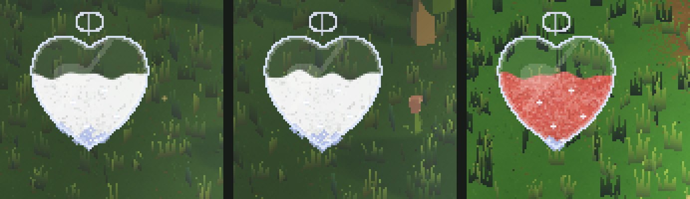
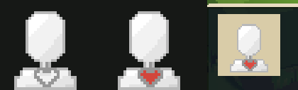

## 八个人，八种颜色，四组性格轴

每个人物身上是一种颜色，也代表一条两两对立的性格轴中的一端。结构参考 MBTI 的四个维度，但游戏里不使用 MBTI 的名称或类型缩写，全部用自创的中性词：

| 轴 | 一端 | 另一端 |
| --- | --- | --- |
| 能量 | 红 · **向外**（热情直率） | 蓝 · **向内**（冷静责任） |
| 判断 | 黄 · **讲理**（理性求知） | 绿 · **讲情**（温和共情） |
| 目光 | 紫 · **看向远方**（浪漫理想） | 橙 · **看重脚下**（务实当下） |
| 步调 | 青 · **守序**（秩序计划） | 粉 · **随性**（自由即兴） |

| 颜色 | 性格 | 人物 | 他们身上的东西 |
| --- | --- | --- | --- |
| 红 | 热情直率 | 阿燃（信使） | 等一个不一定来的人，却还是跑完了全程 |
| 黄 | 理性求知 | 阿衡（修表匠） | 修了七年一只慢四分钟的表 |
| 绿 | 温和共情 | 阿禾（园丁） | 为一个人种了三年的花，最后自己看 |
| 蓝 | 冷静责任 | 阿砚（守路人） | 年轻时也想走，后来留下来守路 |
| 紫 | 浪漫理想 | 阿遥（画者） | 画一片没去过的远方 |
| 橙 | 务实当下 | 阿作（木匠） | 不修好眼前这张桌子，就不谈以后 |
| 青 | 秩序计划 | 阿序（抄书人） | 每天把路过的风、来客、影子记进册子 |
| 粉 | 随性自由 | 阿游（放风筝的人） | 行囊里没有地图，只有一只风筝 |

对话里的性格不直接说破：每个人物通过说话方式、在意的东西、以及**对你不同回答的不同反应**慢慢显出来。
每个 NPC 的对话里有 **3 个中途选择**（不同回答会得到不同回应，并带有隐藏权重），**没有**最后那句「我是这样的人吗」：对话结束时游戏根据你的回答判断你是否偏向对方那种人，再决定要不要把颜色留下——判断结果用一句内心独白和取色演出告诉你。

补充：
- 8 个 NPC 分别对应 4 条轴的两端；你取下的颜色决定了每条轴往哪边偏。
- 一条轴的两端都没选 → 这一面「还没有答案」；两端都选了 → 这一面「两边都有」。
- 所以「找到自己」不是选一个最好的颜色，而是看你最终在四条轴上站在哪里。

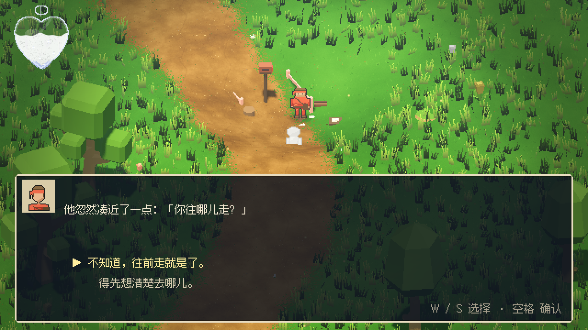
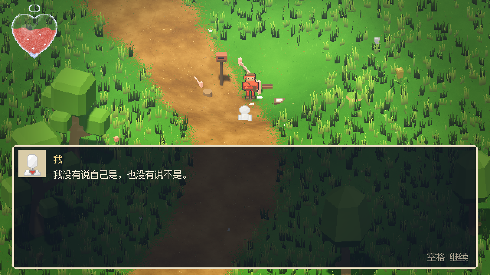

## 心形凹槽与结局

- 每次对话结束，若游戏判断你偏向该 NPC，就把他的颜色**等权混合**进左上角的爱心流麻（Oklab 空间平均）；没有偏向则不变。这个判断来自三个选择的隐藏权重，不是一句「我是这样的人吗」的自问。
- 结局按**选择过的颜色集合**判定（不是最终混合色）：
  - 一次都没选 → 纯白结局
  - 1 种颜色 → 单色结局（8 个）
  - 2 种颜色 → 双色组合结局（C(8,2)=28 个；原来的 10 个是手写，其余由两种颜色的短句自动组合）
  - 3–8 种颜色 → 多彩结局（3/4/5 手写，6–8 自动组合）

原来的 **19 个手写结局**保留，新颜色的组合会生成同样语气的文本：

| 类型 | 结局 |
| --- | --- |
| 纯白 | 空白 |
| 单色 | 先走的人（红）· 把问题带在身上的人（黄）· 会停下来的人（绿）· 守夜的人（蓝）· 往远处走的人（紫）· 把东西做好的人（橙）· 把日子装订起来的人（青）· 跟着风走的人（粉） |
| 红+黄 | 边跑边问的人 |
| 红+绿 | 替别人冲在前面的人 |
| 红+蓝 | 先扛住，再说话的人 |
| 红+紫 | 朝火烧的方向走的人 |
| 黄+绿 | 一边观察一边心疼的人 |
| 黄+蓝 | 把灯举稳的人 |
| 黄+紫 | 给远方画地图的人 |
| 绿+蓝 | 温柔地守着的人 |
| 绿+紫 | 把花种在远方的人 |
| 蓝+紫 | 守着一片还没到的风景的人 |
| 多彩 | 杂色的人（3 色）· 万花筒（4 色）· 很多颜色的人（5 色以上，自动组合） |

结局画面之后按 `空格` 会打开**性格画像页**：

- 四行轴（能量 / 判断 / 目光 / 步调），每行左右两端用对应颜色标出；
- 你取过哪一端，哪一端就亮起；两端都取过 → 两边都亮；两端都没取 → 两边都暗；
- 顶部标题会给出「向外 · 讲理 · 看向远方 · 随性」这样的组合，或「还在成形」；
- 底部是一段由你选择自动拼出的总结。再按 `空格` 重新走一遍。

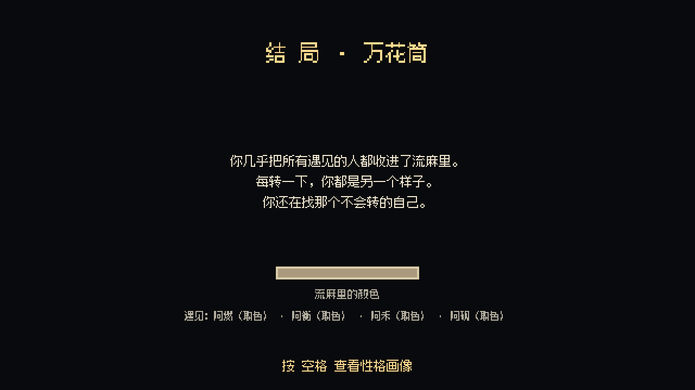
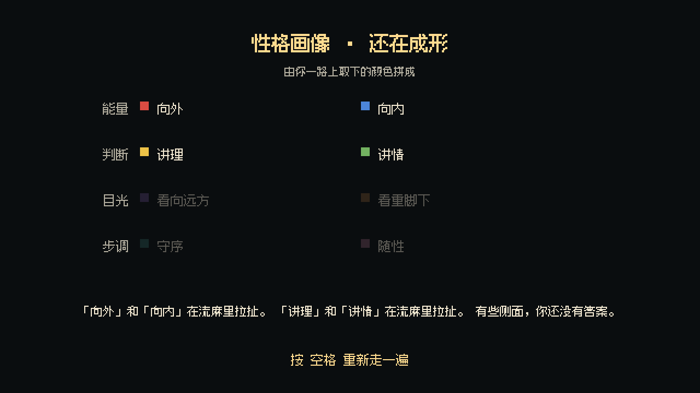

## 文案（可审核 / 可改）

所有中文文本都在**[scripts/game/narrative.gd](scripts/game/narrative.gd)**，是纯数据表，改字不需要动代码：

- `NPCS`：八个人物的名字、精灵图、对话（`line` 台词 / `choice` 带隐藏权重的三个选择；不再有最后的「是不是」问题）
- `MONOLOGUES`：六段独白（3 段纯风景 + 3 段新 NPC 段落的引入）
- `ENDINGS`：19 个手写结局；`ending_for()` 负责给新颜色组合生成文本
- `COLORS`：8 种颜色、性格标签、实际色值与所属轴；`AXES`：四组性格轴
- `portrait()`：由取色集合计算四轴画像（结局后的第二页）

人物小传与结局设计意图见 **[docs/STORY.md](docs/STORY.md)**；模型/场景工具与插件建议见 **[docs/PLUGINS.md](docs/PLUGINS.md)**。，可以先看摘要再决定改哪里。

## 画面怎么来的

- 沿用之前的 HD2D 风格：低分辨率 640×360 渲染 + 整数放大、正交相机、3D 草地世界、2D 像素小人。
- 十一段场景由 `scenes/segment/segment.gd` 参数化生成：起伏地形、过渡式泥土小径（路径遮罩直接烘进地形材质，由 Catmull-Rom 采样生成；边缘像素抖动融入草地，没有独立路片）、约 60 万级三层草叶 MultiMesh（单叶 + 每根一张交叉叶 + 细发丝草）+ 风摆 / 踩踏 shader、Kenney 低模树/石/灌木/花、天空/太阳/雾/色调映射/景深/暗角，全部按 `scripts/game/segment_presets.gd` 的 11 组参数生成，最后放一个点灯的石柱门。
- 颜色不再染木偶人：木偶人始终是木头本色；`scripts/ui/charm_hud.gd` 负责玻璃爱心容器、取色混合、液体/沙粒颠动和闪粉物理，液体 mixing 在 `shaders/ui/charm_liquid.gdshader`。
- 对话 UI 是自写的像素风面板 + 打字机效果，字体为 **Fusion Pixel 12px（OFL 开源字体，中文像素字体）**；对话框打开时相机会自动下移约 0.7 m，把角色整体抬高 ~20 px，面板不会挡住小人的下半身。

### 美术细化（本轮）

- **角色立绘**：木偶主角与 8 个 NPC 的 32×48 像素图重绘；木偶有球关节、木头本色和胸口心形空槽，NPC 的头巾/披风、围巾/圆眼镜、草帽/围裙、提灯、宽檐帽/画板等标志物更明确。
- **对话头像**：对话框左侧是 32×32 像素头像；NPC 各有自己的头像；玩家头像改成**木偶半身 + 胸前空槽**，只给槽内叠一层当前混合色。
- **贴图**：草地、泥土路、草叶、小花、对话面板重绘，增加了细草、碎石、车辙、绒边等层次；平均亮度和色相与原来保持一致，不改变整体氛围。
- **近路植被/杂物**：使用项目里已有的 **Kenney Nature Kit（CC0）** 新增蕨类、蘑菇丛、倒木、3D 小花、扁平石子、旧木栅栏，按段落配置不同密度。
- **环境粒子**：白天段落下有花粉/尘埃缓缓漂浮；黄昏与夜晚段有萤火虫。
- **开始页**：第一次开始的标题页改成一片暖白留白 + 几块光圈、薄雾和漂浮微尘；上方加了一道更刺眼的逆光光束、镜头光斑和横向光晕（加法混合、缓慢漂移/呼吸），开始后从白色淡入世界。

> 细节道具数量与粒子数量都在 `scripts/game/segment_presets.gd`：`detail_fern_count` / `detail_mushroom_count` / `detail_log_count` / `detail_flower3d_count` / `detail_stone_count` / `detail_fence_count`、`particles` / `particle_amount`。

### 起伏地形、池塘与更密的树

- **起伏地形（剧情化）**：每段用确定性高度场生成大起伏 + 10–25 m 小土坡，并叠加**故事高程曲线**：`elevation_start → elevation_end` 沿路爬升/下降，`ridge_height` 在路中段造山脊或谷地，`terrain_side_lift` 把路两侧抬起成浅谷山坡；越往后（山道、高地、风坡、旧阶、山顶）起伏越大，最终走向山顶。地面 shader 按坡度和高度加深/提亮，地形参与投影，坡面和高差更明显；出生点/NPC/出口会压平成局部平台，**路径中心 1.35 m 内也会被拉平到最近路径点的高度**，向外 3.8 m 渐变，所以路更平缓、不再跟着每个小土包上下。
- **过渡式土路**：路不再是一层单独的薄片，而是**直接烘进地面材质**：地面 shader 用一张 512×512 的路径遮罩混合草地与泥土贴图，边缘用世界坐标哈希做像素抖动。因此路和地形在同一层，**永远不会盖到小人脚上**（之前“脚变色/脚消失”都是独立路片在小人前面抢深度）。出生点和出口处路会继续延伸到场景边缘。
- **池塘**：每段沿着路边自动选 1 个（溪边段 2 个、山顶 0 个）位置挖出碗状凹陷，水面用自定义 shader（径向淡出、波纹、菲涅尔反光），岸边配石子、芦苇和水面睡莲。
- **树与最外圈树墙**：每段约 1300 株树，树高范围 2.8–5.4 m；每段从 11–19 种树形里抽取：detailed / tall / thin / plateau / simple / blocks、圆冠与高针叶松、深色与秋色变体，并给每棵树叠加细微的色相/明度随机，邻近两棵即使同模型也不完全一样。墙外新增了**三层交错的高树 + 两排连续灌木墙**，第一/第三人称都看不到地图外；碰撞藏在树墙后的 26 m 围墙里，玩家走不出去。外侧树幕站在正常高度的地形环上，不会掉到低处底板。
- **草**：约 60 万级的 MultiMesh 草叶，分三层：细单叶 / **每根草都配一张交叉叶**（交叉角略微随机，形成编织感） / 每 3 根再加一根更细更高的发丝草，另加每 5 根一簇的多叶草簇。草格加密到 0.18 m、单片草宽缩到 0.16 m、草高 0.50 m；大尺度密度噪声让草呈一片片浓密草丛，角色走过时 shader 把草压弯、拨开，离开后恢复。
- **边界与完整碰撞**：出生点南侧有横贯场景的隐形挡墙，每个池塘内有随水位抬高的隐形圆柱；地图最外围的视觉边界已经换成密集交错的树墙和灌木墙，物理碰撞藏在树墙后，第一/第三人称都看不到外面；所有实体道具现在都有碰撞——树干（含树苗、边界树）、灌木、大小石头（含池塘边石头）、圆木/木堆、栅栏、扁平石、NPC、出口石柱；草、花、蕨类、蘑菇、芦苇这类可穿过的植物保持无碰撞。
- **出口/低洼处**：背景底板会按当前场景的**最低地形**下沉，不会盖住出口附近的路和草（之前出口前出现大片空绿，就是这个底板挡住地面）。
- 可调：`scripts/game/segment_presets.gd` 里每段的 `hill_height`、`elevation_start/end/arc`、`ridge_height/pos/width`、`terrain_side_lift`、`terrain_cross_slope`；`segment.gd` 里的 `_base_hill_height` / `_macro_height`、`_tree_view_clear` / `_avenue_tree_spots` / `_foreground_sapling_spots`；`shaders/segment/ground.gdshader` 的 `slope_shade` / `height_tint`。

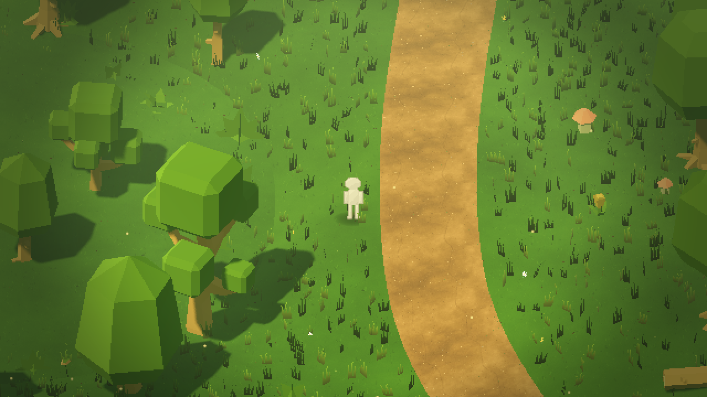
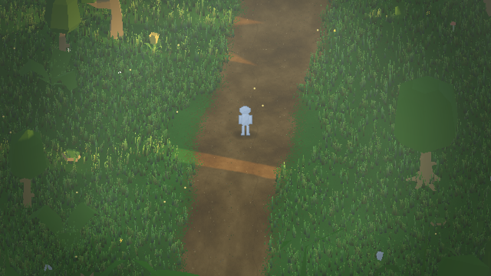
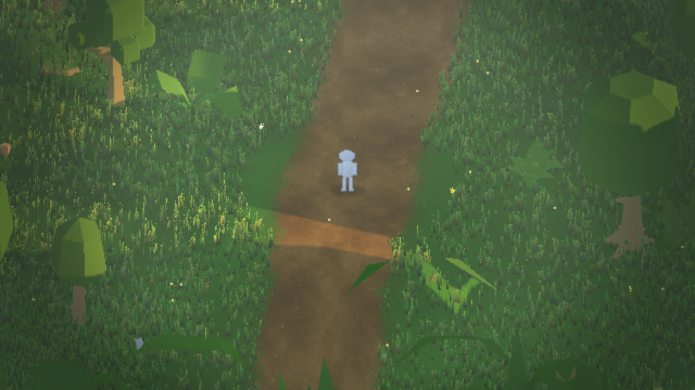
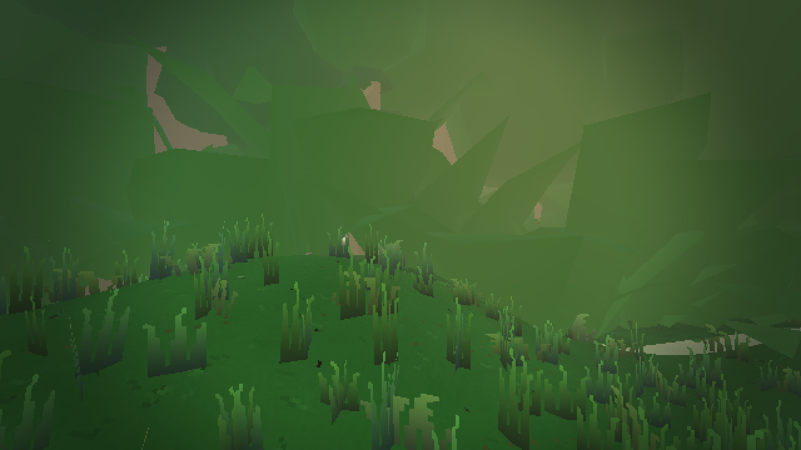

### 四 · 溪畔：清澈小溪与木桥

之前这段的独白说「溪水很浅，能看见底」，但地图里只有池塘。现在出生点前方真的有一条横穿小路的小溪：

- 小溪改成 **S 形弯道**；水面是**同一水平的水平面**，河床深浅沿路起伏；水面用独立透明 shader，浅处透出河床碎石，深处偏青；
- 河床铺了泥土/砾石贴图，两岸有石块、芦苇、水边泡沫线；河床深度沿 S 弯变化；
- 河的两端不再通向地图外，而是进入**岩石山体和黑暗洞口**：洞口有可见的黑色隧道、岩石拱和山体，内部有隐形碰撞，玩家不能顺水走出地图；
- 河道内不再生成树木，随机树木会避开整条河槽和两端洞区；
- 小溪横穿小路的位置架了一座**全木拱桥**：弧形木板桥面、两侧拱形木梁、木栏杆、木桩支撑和斜撑；没有石材，桥面有弧形碰撞；
- 小溪的 `creek` 参数（位置、宽度、深度、坡度、桥）在 `scripts/game/segment_presets.gd` 的「四 · 溪畔」段里，可单独调。

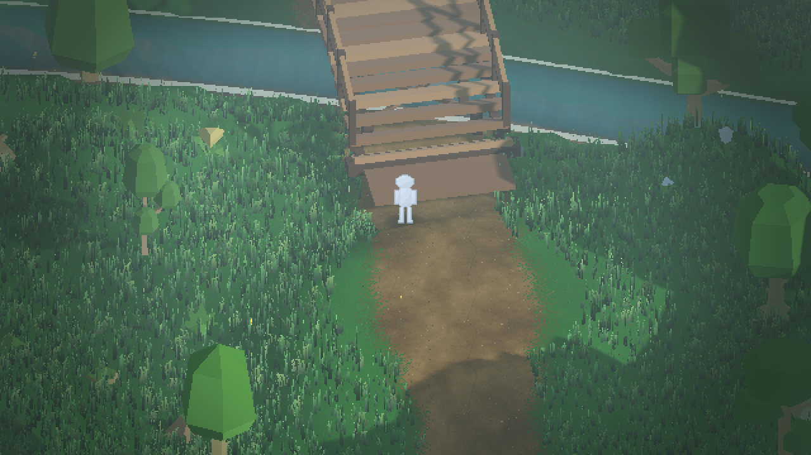
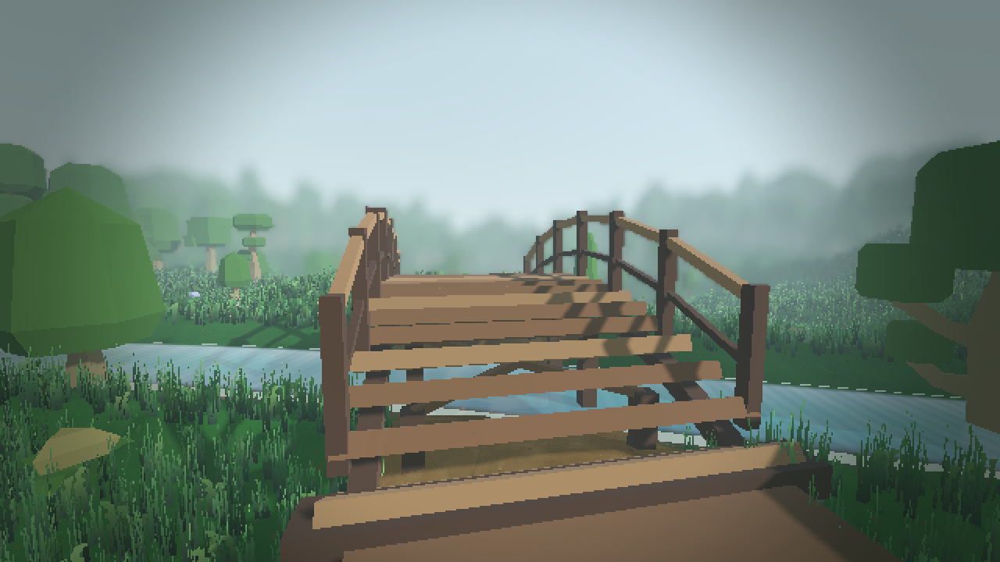
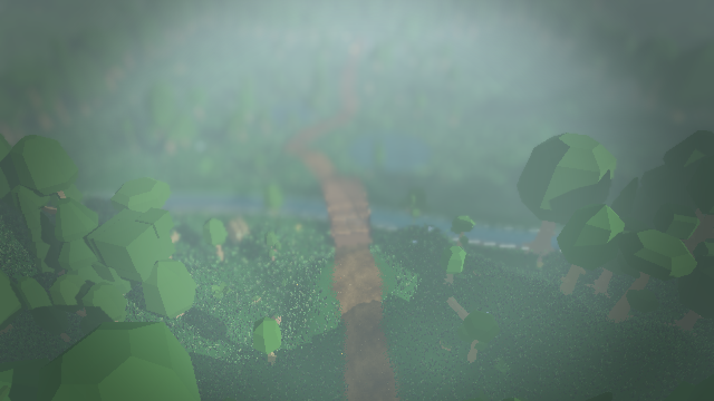
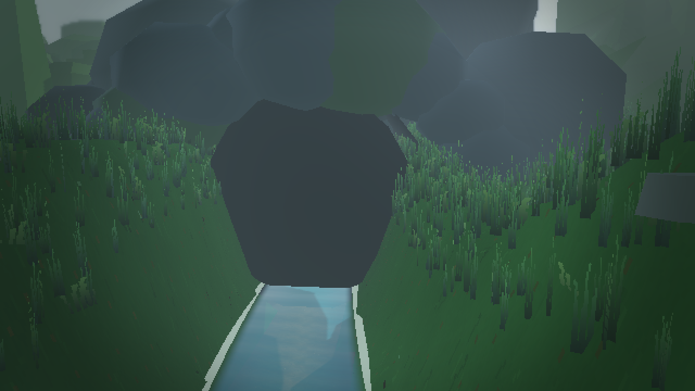

### NPC 立绘、独立模型与建筑场景

- **2D 立绘**：8 个 NPC 各有一张 128×192 的透明像素立绘（`assets/generated/npc_illustration_*.png`），只作为人物/模型设计参考，**不再在对话里显示**；
- **模型按立绘重做**：不再是同一个身体加不同配件。每个人的身高、肩宽、头部比例、发型/帽子、体态都不同（例如绿色更圆润、橙色更宽肩、蓝色更高挑、粉色更娇小）；
- **建筑场景**：围巾/地毯不再是主体，每个 NPC 后面有符合身份的完整建筑：
  - 红·阿燃：木制邮局窗口、信箱、包裹堆和红色雨棚；
  - 黄·阿衡：钟表店木筋墙、橱窗、挂钟和招牌；
  - 绿·阿禾：玻璃温室、木框、花圃和水壶；
  - 蓝·阿砚：石砌门房、木门、提灯和路牌；
  - 紫·阿遥：画廊墙、画框、画架和工作室屋顶；
  - 橙·阿作：木工棚、工具墙、木料架和工作台；
  - 粉·阿游：旅行帆布棚、帐篷杆、营地箱和风筝；
  - 青·阿序：档案书架、彩色书脊、阅读桌和屋顶；
- **对话后场景变化**：和 NPC 聊完后，建筑里的暖灯/招牌会亮起，表示这个人的小地方真正“醒过来”。

### NPC 的 3D 小场景与头部注视

每个 NPC 站在路边都有自己的“小摊/工作角”，并且在你靠近之前一直在做自己的事。人物本体现在是**低多边形 3D 角色**，不再是面向镜头的 2D 纸片：

- **平整地基**：NPC 周围地形会被压平成半径约 3.4 m 的小空地，铺一块地毯，家具/围栏/信件/工具都直接落在平地上；不再使用凸起的台面，所以不会和地形互相穿插、也不会在移动时闪烁；
- **身体固定**：躯干、腿和脚的朝向不变，不会整体转身追着玩家；
- **只有头会看人**：头部在左右约 **±58°**、上下约 **±16°** 内转向玩家；玩家走到背后或超出可转范围，就只能看到侧脸/后脑；
- **面部细化**：眼白、瞳孔、高光、眉毛、鼻子、嘴、腮红都用独立的小块面片做出；不同 NPC 还有眼镜、草帽、宽檐帽、头巾、围巾、围裙、挎包等身份配件；
- **动作**：7 m 外继续做自己的小动作（手臂工作、提灯、风筝、风车等），走近后手臂放下、身体动作停住，只把头转向你；对话中也会看着你。

- **形象按性格重做**：
  - 红·阿燃：红头巾 + 斜挎邮包 + 卷起的袖子，热情的信使；
  - 黄·阿衡：深色背心 + 圆眼镜 + 怀表链，理性的修表匠；
  - 绿·阿禾：草帽 + 围裙 + 花徽 + 雀斑，温和的园丁；
  - 蓝·阿砚：长外套 + 帽子 + 围巾 + 肩包，冷静的守路人；
  - 紫·阿遥：宽檐帽 + 画袍 + 颜料点 + 耳后画笔，浪漫的画者；
  - 橙·阿作：工作围裙 + 工具腰带 + 手套，务实的木匠；
  - 粉·阿游：层叠围巾 + 羽毛 + 旅行外套，随性的旅人；
  - 青·阿序：高领长袍 + 圆眼镜 + 书袋 + 发髻，守序的抄书人。
- **服装/道具落地**：所有角色共用同一块平整地基；围裙、围包、栏杆、木料、画架、花圃、工具等都有明确的落地面，不再使用悬空台面。

| NPC | 小场景 | 工作动作 |
| --- | --- | --- |
| 阿燃（红·信使） | 地毯、信箱、邮包、散落的信件、小凳、木栏 | 翻邮包、抽信、卷信、读信、张望 |
| 阿衡（黄·修表匠） | 工作台、时钟零件、放大镜、小台灯、书、凳子 | 举放大镜、俯身、拧零件、抬头思考 |
| 阿禾（绿·园丁） | 花圃、水壶、篮子、带靠背长椅 | 提水壶、浇水、擦汗、摘花 |
| 阿砚（蓝·守路人） | 提灯柱（真的会发光）、石堆、木栏、木杖 | 提灯、擦灯罩、看火苗、望路 |
| 阿遥（紫·画者） | 画架（画布上是晚霞）、颜料罐、画笔、凳子 | 举笔、落笔、退后看、蘸颜料 |
| 阿作（橙·木匠） | 木工台、木料、锯子、木屑 | 量线、锯木、刨木 |
| 阿游（粉·旅人） | 风筝线、风车、旅行包 | 放线、收线、看风筝 |
| 阿序（青·抄书人） | 矮案、纸册、笔架、石块 | 研墨、抄写、翻页 |

- 可调：`scenes/npc/npc.gd` 的 `NEAR_RADIUS`（停下距离）、`HEAD_YAW_LIMIT` / `HEAD_PITCH_LIMIT`（头部可转范围）；身份配件在 `_build_character()` 的 `match npc_id` 里。

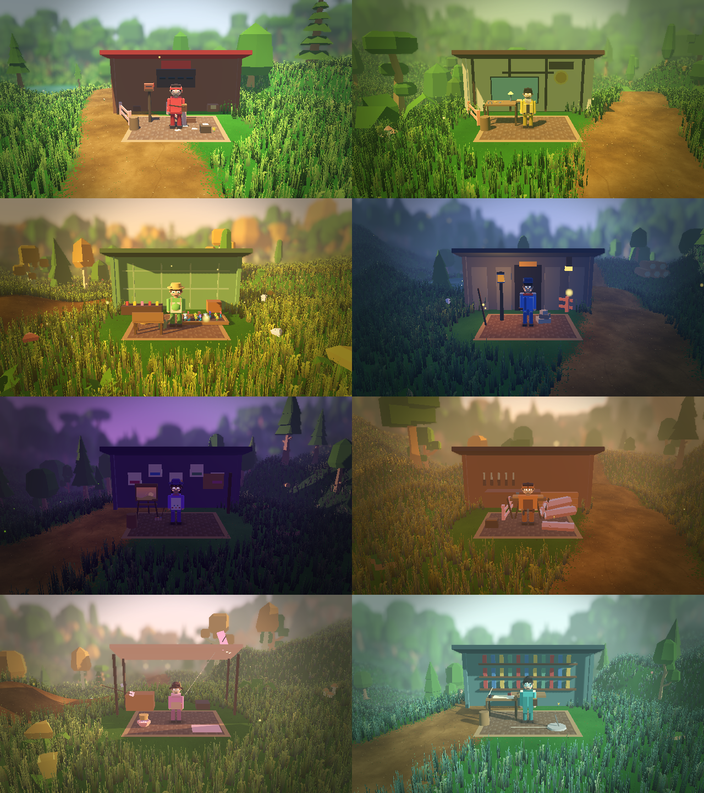
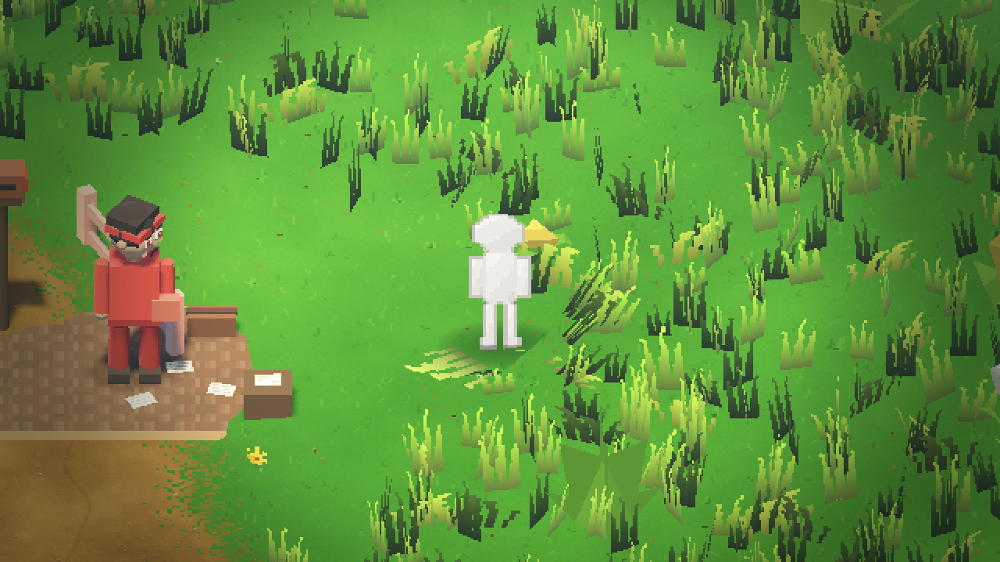
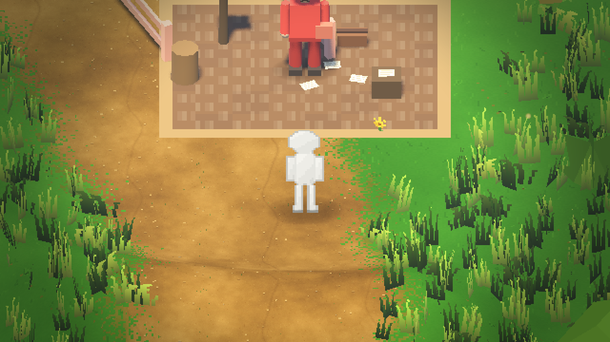

## 背包与 NPC 道具

和 NPC 好好聊完后，对方会把一件随身物交给你；道具会自动放进背包，并在左上角短暂提示「获得…」。按 **B** 或 **E** 随时打开背包（NPC 交互范围内 E 仍先交谈），`Esc` / `B` / `E` 关闭。

- 背包左侧是 8 个格子，没拿到的显示「？？？」；右侧是一块 **3D 预览窗**，选中的道具会缓慢旋转；
- 每件道具都有独立低多边形模型，不是 2D 图标：信、怀表、花种纸包、提灯、画片、木雕小马、风筝线轴、书签；
- 道具随存档保存；背包分页/选择支持鼠标和方向键。

| 来源 | 道具 | 说明 |
| --- | --- | --- |
| 红·阿燃 | 没寄出的信 | 收信人一栏空着 |
| 黄·阿衡 | 停摆的怀表 | 指针停在某个下午 |
| 绿·阿禾 | 花种纸包 | 写着「春天再打开」 |
| 蓝·阿砚 | 旧提灯 | 灯罩很亮，灯芯很短 |
| 紫·阿遥 | 晚霞画片 | 一张没画完的晚霞 |
| 橙·阿作 | 木雕小马 | 鬃毛刻得很细 |
| 粉·阿游 | 风筝线轴 | 线头系着一小片风筝纸 |
| 青·阿序 | 手抄书签 | 背面抄着一行旧诗 |
| 溪畔石阵 | 溪畔风铃 | 三块石头按晨光→山→家点亮后获得 |

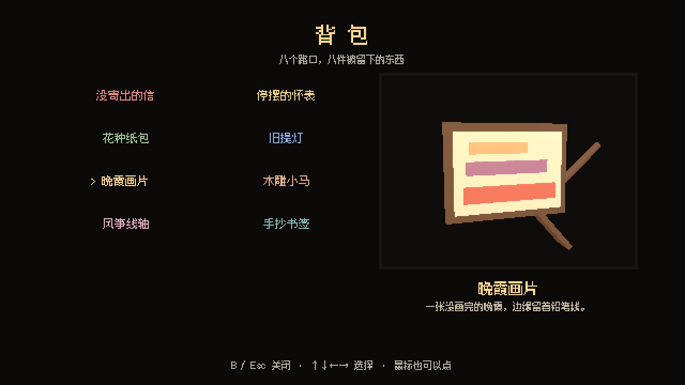

### 木偶主角与开局的 3D 序章

启动游戏先进入**标题菜单**；选择「开始游戏」后进入草坡上**一位出门木匠的家**：

- 主角是一尊**木偶人**：木质球关节、雕刻躯干、木头本色，胸口有一个**空的心形凹槽**；
- 序章开头旁白：「我在一间木匠的屋子里醒来。屋里没有人，刨花还带着新木头的味道。」；
- 木匠本人不在家，门边留着他的外套和靴子，工作台上还有做到一半的木偶、心形木坯和工具；
- **房屋是单独的场景**：`scenes/vision/carpenter_house.tscn` + `scripts/vision/carpenter_house.gd`，不再写在草坡场景里，方便单独改格局；
- 房子扩大到约 **18×24 m**，分为木工区和生活区：木工台、锯木架、工具墙、木料架、车床、雕刻台、满地刨花；生活区有床、木桌、椅子、壁炉、书架和木箱；
- 木雕包括熊、猫头鹰、鱼、鸟、木面具、浮雕板、心形木坯，以及木匠正在做的木偶；墙上还钉着木偶人的设计图；
- 北面木门通向草坡；出门后即进入草坡序章，沿踏石小路走到白风车，按 **E** 开始旅程；
- 在木屋或草坡按 **Esc** 打开暂停菜单，可选「继续」或「返回标题」；通关并看完性格画像后按 **空格** 回到木匠家重新开始。
- 全屏由项目启动设置锁定，序章进入时不再额外改窗口模式；第一人称鼠标视角在 `_input` 里处理，不会被 UI 吞掉；木偶会按 8 个方向转身行走。

木偶的 2D 立绘、HD2D 像素行走图和 3D 模型是同一套设计：木头本色、球形关节、围巾，以及胸口的心形空槽。HD2D 行走图是 **8 方向 × 4 帧**；序章里的 3D 木偶也会按 8 个方向转身，不再是固定朝向滑行。

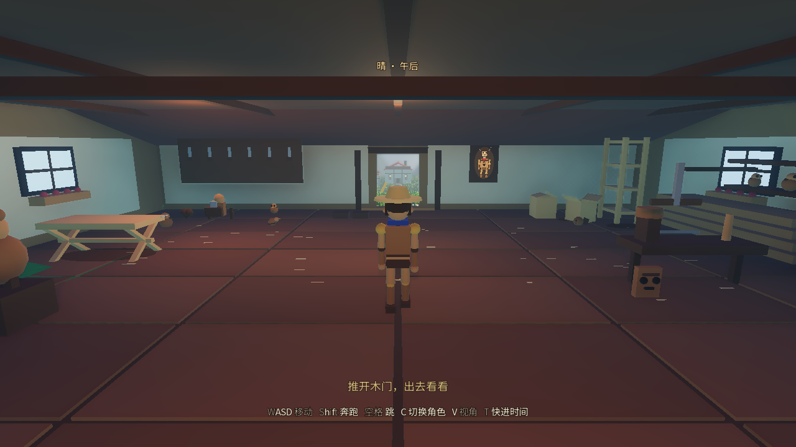

序章房间也做了一次清理：删掉重叠的第二张工作台、悬浮木板和重复纸箱；工作台上的木偶/雕刻重新落位；家具增加实体碰撞和接触阴影；原先悬在墙边的木雕改为落地摆放。
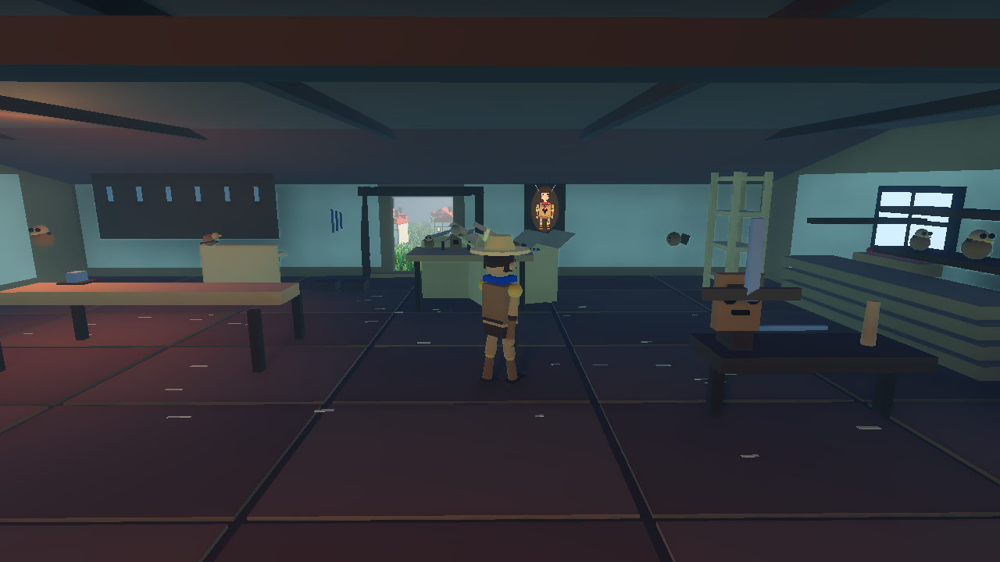
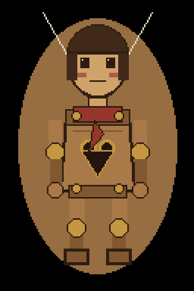
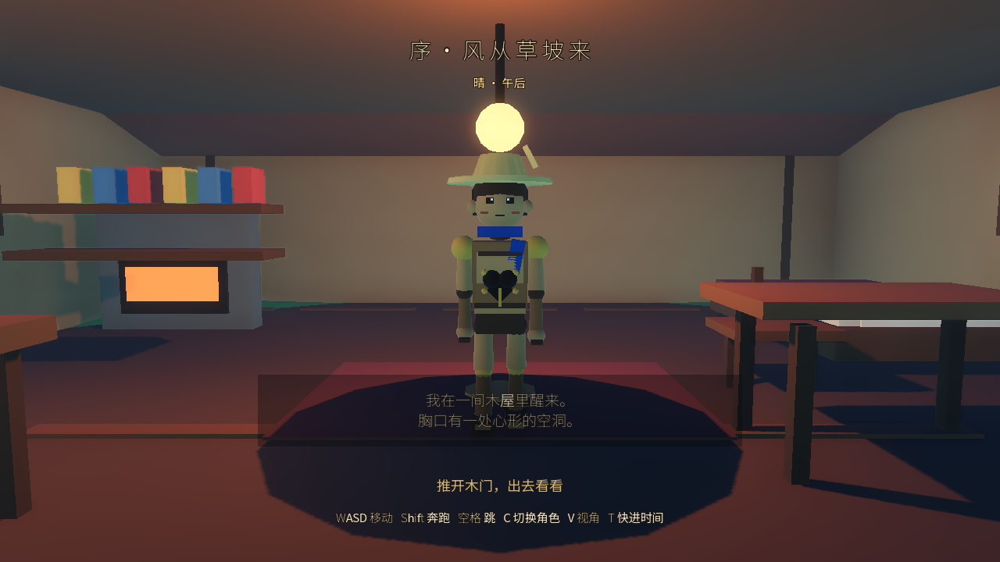
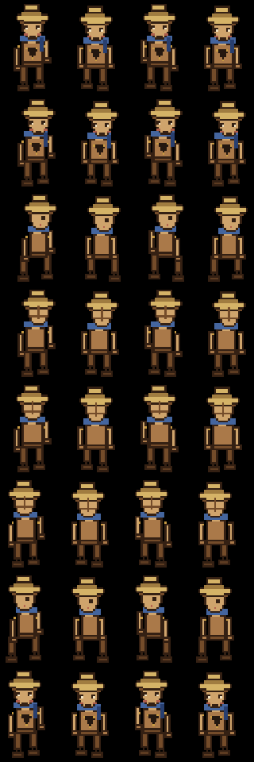
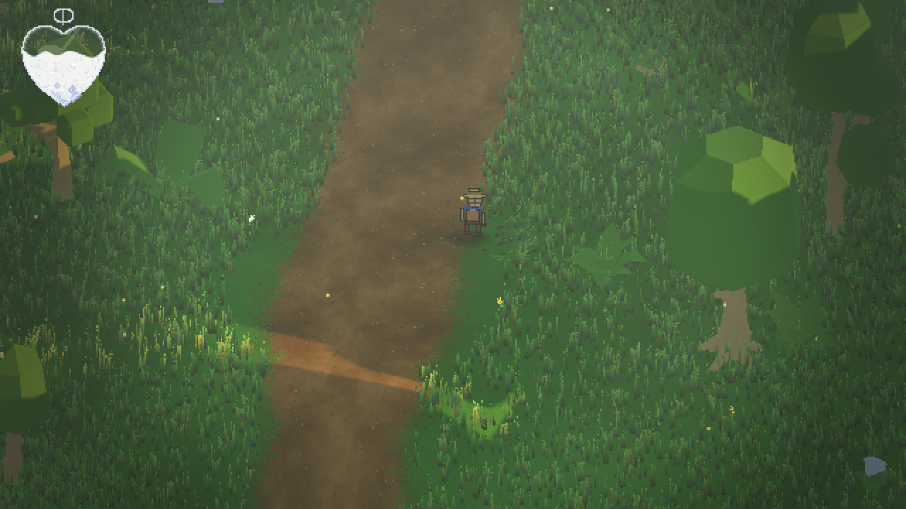
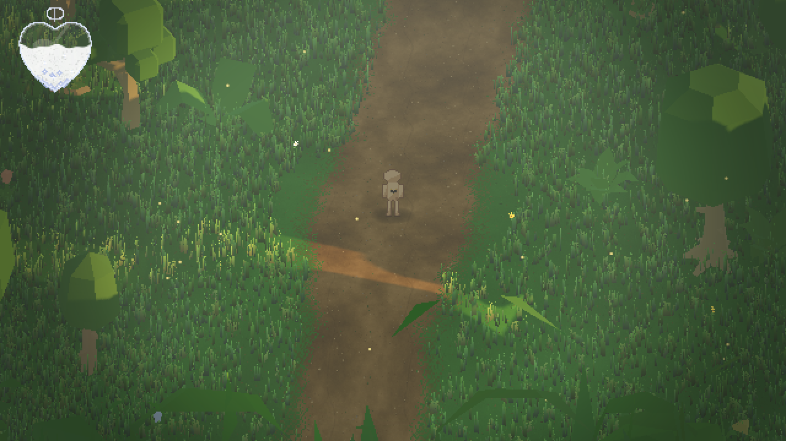

### 溪畔石阵（可选解谜）

四 · 溪畔的河岸边有一组可选的石阵：

- 石碑刻着：「先有晨光，再有山，最后才是家」；
- 旁边三根石柱分别刻着太阳、山、屋顶，但排列顺序被打乱；
- 走近石碑按 **E** 阅读线索，走近石柱按 **E** 触碰；
- 顺序错误三根石柱会一起熄灭并重置；
- 按 **晨光 → 山 → 家** 的顺序点亮后，中央石炉燃起，获得特殊道具 **「溪畔风铃」**；
- 溪畔风铃有独立 3D 模型，会出现在背包第 9 格，不属于任何 NPC。

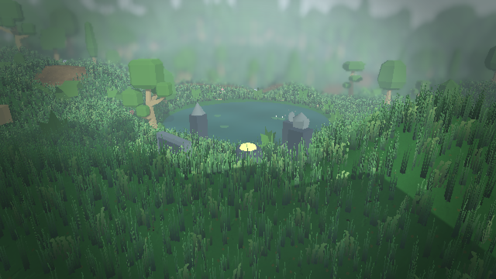
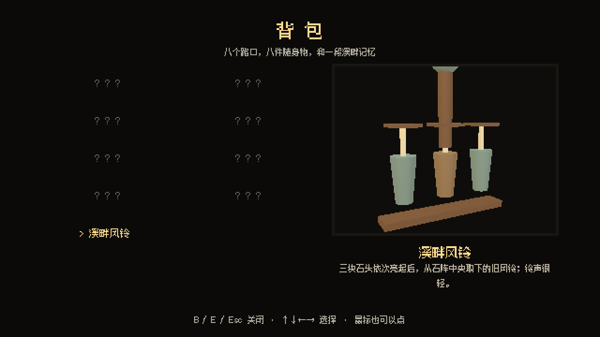

### 声音与字体

- **音乐**：`AudioDirector` 在启动时程序化生成 24 秒循环环境音乐，不依赖外部音频文件；
- **场景主题「四·溪畔」**：32 秒循环，D 大调，和声走向 D–Bm–G–A；用柔和 pad、竖琴式琶音、五声音阶旋律和很轻的水声铺底。进入溪畔段自动切到这首，离开后回到环境音乐；
- **音效**：脚步（两种随机音高）、跳跃、落地、UI 悬停/确认、对话打字、选项、交谈、取色、道具拾取、解谜成功/失败、过场、暂停、背包、视角切换、结局等都有独立音效；
- **字体**：从像素字体换成了 **Noto Sans SC**（已做子集化，约 450 KB），界面字号整体放大约 10%，对话框也放大到 13 px；
- 音量统一走 Master 总线，设置里的音量会影响音乐和所有音效。

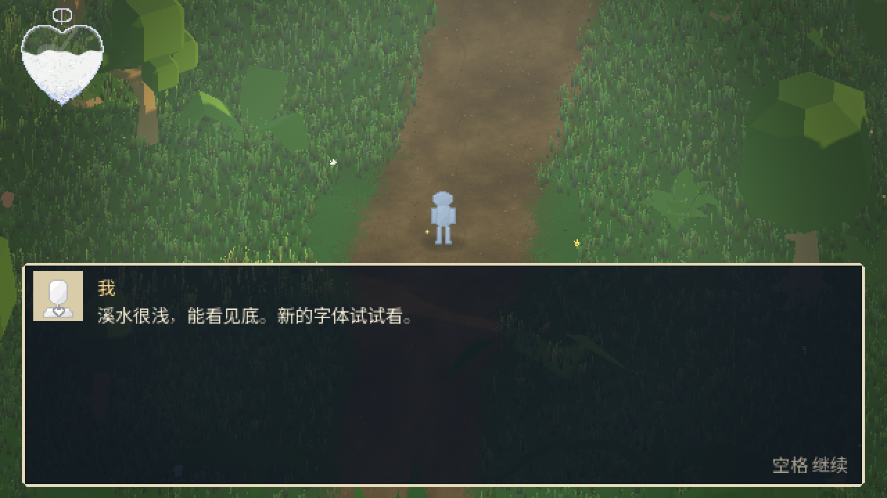

## 模型资产替换（路线 A）

已开始把程序化 primitive 换成 CC0 资产：

- **NPC 角色**：`assets/free/kenney_blocky_characters/`，来自 Kenney **Blocky Characters 2.0**（18 个皮肤、27 个动画，CC0）。8 个 NPC 按颜色/性格映射到不同皮肤，播放 idle 动画；NPC 建筑、地毯和身份道具保留。
- **木匠家家具**：`assets/free/kenney_furniture/`，来自 Kenney **Furniture Kit**（CC0）。床、桌子、椅子、书架、长凳、衣帽架、纸箱、落地灯已经替换为真实低模模型；工作台/工具墙/木雕仍保留手工细节。
- 已导入资源都附带 `LICENSE` 文件，CC0 可商用；不需要署名（但项目里保留了来源说明）。
- **还没有替换**：木偶主角和 NPC 建筑外壳仍是程序化模型，因为木偶需要心形凹槽和特殊骨骼；这部分建议走 Blender/MPFB2 路线 B，或先用 AI 图生 3D 做木雕/建筑构件。

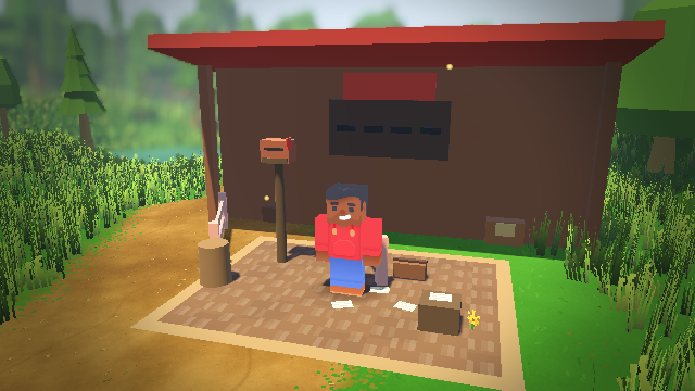
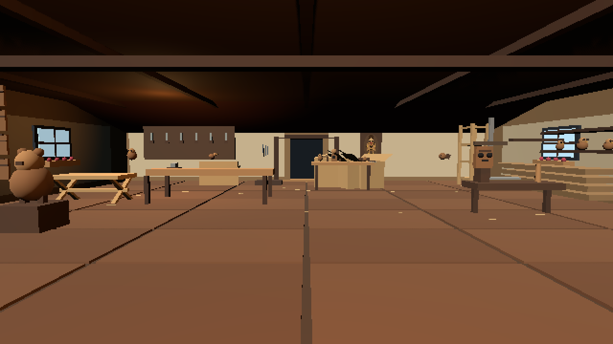


## 开发者控制面板（仅调试版）

按 **F1** 或 **`** 打开/关闭。面板只在调试构建里创建（`OS.is_debug_build()`），正式导出的 release 包会自动隐藏；最终发布时也可以把 `scripts/game/game.gd` 里的 `DEV_PANEL_ENABLED` 改为 `false`，或直接删除 `scripts/dev/`。

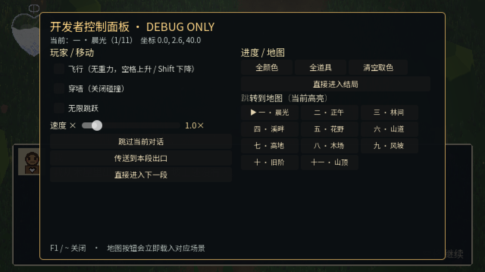

包含：

- **玩家**
  - 飞行：无重力，空格上升 / Shift 下降；
  - 穿墙：关闭碰撞；
  - 无限跳跃；
  - 速度倍率 0.5×–5×；
  - 跳过当前对话；
  - 传送到本段出口；
  - 直接进入下一段。
- **进度**
  - 一键获得全部 8 种颜色；
  - 一键获得全部 9 件道具（含溪畔风铃）；
  - 清空已取颜色；
  - 直接进入结局。
- **地图选择**
  - 列出全部 11 张地图，当前地图高亮；
  - 点击任意地图立即载入对应场景，方便逐张检查地形、NPC、建筑和解谜。

面板打开时会锁住角色操作并显示鼠标，关闭后恢复原来的输入/鼠标状态。

## 目录结构

```
hd2d-rpg/
├─ project.godot                 # 主场景 + 输入映射 + GameState 自动加载
├─ scenes/
│  ├─ main.tscn                  # 游戏根：段管理 / 对话 / 结局 / 淡入淡出
│  ├─ vision/                    # 开局木匠家 / 草坡 / 风车 3D 序章
│  ├─ vision/carpenter_house.tscn # 独立的木匠家室内场景
│  ├─ segment/                   # 参数化场景构建器（11 段共用）
│  ├─ npc/                       # NPC 低多边形 3D 身体 + 头部注视 + 影子 + 碰撞
│  ├─ player/                    # 木偶人（球关节/心形空槽，本体不染色）
│  ├─ ui/charm_hud.gd            # 左上角心形凹槽 HUD（取色/液体/闪粉）
│  ├─ ui/dialogue_ui.tscn        # 自写像素对话框
│  ├─ game/camera_rig.tscn       # 正交跟随相机
│  └─ world/                     # 旧的原型开阔草地（保留参考）
├─ scripts/game/
│  ├─ game.gd                    # 主流程：段切换 / 对话 / 结局 / 存档与启动演出
│  ├─ game_state.gd              # 全局：取色、Oklab 混色、结局 key
│  ├─ save_system.gd             # 存档 JSON + 退出截图（user:// 优先，回退项目 save/）
│  ├─ narrative.gd               # 全部中文文案（改这里）
│  └─ segment_presets.gd         # 十一段场景参数
├─ scripts/player / npc 等
├─ assets/generated/             # 程序化生成的像素素材（角色 / NPC / 草 / 路 / 面板）
├─ assets/fonts/                 # Fusion Pixel 像素中文字体（OFL）
├─ assets/free/kenney_nature_kit # CC0 低模自然素材
├─ docs/                         # ADDONS / SEGMENTS / WORLD / STORY + 截图
├─ tools/                        # 素材生成器 + 自动测试/截图驱动
└─ addons/                       # Phantom Camera / Aseprite Wizard / Dialogic / GUT
```

## 素材与插件

- 像素素材全部程序化生成（可复现）：`tools/gen_assets.py`（角色/草/阴影/花）、`gen_npc_assets.py` + `gen_polish_sprites.py` + `gen_npc_actions.py` + `gen_npc_extra.py`（8 个 NPC、头像与动作帧）、`gen_rest_assets.py`（坐/躺/起身）、`gen_polish_materials.py`（贴图/粒子）。
- 树木岩石等 3D 素材：**Kenney Nature Kit 2.1（CC0）**。
- 字体：**Fusion Pixel 缝合像素字体 12px 简体（SIL OFL 1.1）**，许可见 `assets/fonts/OFL-fusion-pixel.txt`。
- 已安装的 Godot 插件（详见 [docs/ADDONS.md](docs/ADDONS.md)）：Phantom Camera、Aseprite Wizard、Dialogic 2、GUT。本作没有依赖它们，随时可换。

## 自动验证

`tools/autotest_driver.gd` 可以完整跑一遍流程（正常主循环、自动模拟按键），并用 `--pattern=` 指定八段对话里每个选择选第一条（1）还是第二条（0）（顺序：红 黄 绿 蓝 紫 橙 粉 青）：

| 命令 | 期望 |
| --- | --- |
| `... res://tools/autotest_main.tscn -- --pattern=11111111` | 八色 → `multi_8`「很多颜色的人」 |
| `... -- --pattern=00000000` | 纯白 → `white`「空白」 |
| `... -- --pattern=11000000` | 红+黄 → `pair_red_yellow` |
| `... -- --pattern=10101010` | 红+绿+紫+粉 → `multi_4`「万花筒」 |

全部跑通：结局画面出现、结局 key 与预期一致、玩家取色数量正确、性格画像页可以打开。
另有 `tools/gallery_main.tscn`（一次截取 11 段风景）、`tools/shots_main.tscn`（截标题/对话/对话之后/结局）供回归检查。

## 已知限制 / 下一步

- 现在是 8 色 / 4 条对立轴 / 11 段；四轴画像在结局后作为第二页出现，不做 16 种固定类型命名（避免像测试结果，保留「还在成形」的空间）。
- 中途选择目前只影响 NPC 的反应文字，不改变结局；结局只看最终取色 —— 如果你想让中途选择也影响「我是什么样的人」，可以加「隐性倾向」。
- NPC 是固定站位的 3D 角色，身体不会整体转身，只有头部在限定范围内看向玩家；不会走动。
- 启动画面的背景是**退出瞬间**的截图（隐藏了角色与 UI）；如果游戏被强制结束、没走正常退出，画面可能停在上一次保存时的位置，但进度仍以最新自动存档为准。
- 窗口关闭时会先坐下再截图保存（约 0.8 秒），所以关掉窗口会有很短的停顿，这是故意的。
- 每段场景是独立生成的小场景，不能回头；走完最后一段直接进结局。
- 下一步可做：给四轴画像加 16 种可选的类型小名（收藏用）/ 组合结局细化 / 一次通关里可拒绝后再回头 / 环境叙事（风景里的物件、旧物）/ 存档与章节选择。
